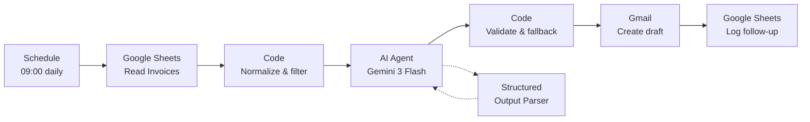

# AR Invoice Reminder Agent

An n8n workflow that chases overdue invoices for you — and never sends anything without a human.

It reads an invoice tracker in Google Sheets every morning, works out how late each invoice is, drafts a payment reminder in a tone that matches the delay, files it as a **Gmail draft**, and logs the follow-up back to the sheet.



## Why this exists

Chasing receivables is the task everyone postpones. A copy-pasted reminder is either too soft (ignored) or too aggressive (damages the relationship), and nobody wants to scroll a spreadsheet to find out who is 9 days late versus 40 days late.

This workflow makes the first pass mechanical: it reads the tracker, applies a fixed tone ladder, writes the draft while the details are fresh, and leaves the send button to a human.

## The tone ladder

The tone is computed in code — not guessed by the model — from the number of days between the due date and today.

| Days past due | Tone | What the email does |
| --- | --- | --- |
| 1–14 | Friendly Reminder | Assumes the client forgot. Warm, no pressure, one gentle nudge. |
| 15–30 | Firm & Direct | States the exact invoice number and the exact amount, then asks for a payment date. |
| 31+ | Urgent / Solution-Oriented | States the balance and offers a payment split plan if paying in full is not possible. |

Every email must:

- stay **under 4 sentences**, excluding the signature
- use **only the data provided** — no invented amounts, links, dates or names
- contain **no placeholders** such as `[Your Name]` or `[Client Name]`
- end with exactly:

  ```text
  Regards,
  [Billing Team]
  ```

- be returned as **flat JSON** with two string keys, `email_subject` and `email_body`

The exact prompts are in [`prompts/system-prompt.md`](prompts/system-prompt.md) and [`prompts/user-message.md`](prompts/user-message.md).

## Guardrails

| Guardrail | Where | What it prevents |
| --- | --- | --- |
| Draft only, never send | Gmail node — `Create Draft` | Anything going out without review |
| Paid / void / cancelled / closed rows skipped | `Normalize & Filter Invoices` | Chasing invoices that are already settled |
| Rows without a valid email, amount, due date or invoice number skipped | `Normalize & Filter Invoices` | Drafts with empty or broken fields |
| 7-day cooldown per invoice | `Normalize & Filter Invoices` | A new draft every single day for the same invoice |
| Output schema enforced | Structured Output Parser | The agent returning prose or markdown |
| Markdown, code fences, banned placeholders stripped | `Validate Draft` | Ugly artefacts landing in the draft |
| Deterministic fallback email per tone | `Validate Draft` | An empty or unusable model response blocking the run |
| Gmail failures continue instead of stopping the run | `Create Gmail Draft` — `onError: continueErrorOutput` | One bad address killing the whole batch |

## How it works, node by node

| Node | Type | Role |
| --- | --- | --- |
| **Daily AR Check** | Schedule Trigger | Fires once a day at 09:00 instance time. |
| **Read Invoices** | Google Sheets | Reads the `Invoices` tab, headers detected automatically. |
| **Normalize & Filter Invoices** | Code (all items) | Parses amounts and dates (including Sheets date serials), computes `Days Past Due`, assigns `Tone`, formats `$1,500.00`, applies the skip rules and the 7-day cooldown. |
| **Draft Reminder** | AI Agent | Gemini writes the reminder from the normalized row. |
| **Gemini 3 Flash** | Google Gemini Chat Model | `models/gemini-3-flash-preview`, temperature 0.3, `maxOutputTokens` 4096 — the higher budget is deliberate, see [Notes](#notes-from-building-it). |
| **Reminder JSON Parser** | Structured Output Parser | Forces `{ "email_subject": "...", "email_body": "..." }`. |
| **Validate Draft** | Code (per item) | Parses the JSON, strips markdown and banned placeholders, converts literal `\n` to real newlines, forces the exact signature, falls back to a template if the body is empty, counts sentences. |
| **Create Gmail Draft** | Gmail | Files a text draft addressed to the client. No send. |
| **Log Follow-Up Date** | Google Sheets | Updates the matched row's `Last Follow-Up Date` and appends the subject to `Notes`. |
| **Sticky note** | Sticky Note | Canvas description of the workflow. |

## Setup

### 1. Import

In n8n: **Workflows → Import from File → `workflow.json`**.

Credentials are stripped from the export on purpose. Attach your own to these four nodes:

| Node | Credential |
| --- | --- |
| Read Invoices | Google Sheets OAuth2 |
| Log Follow-Up Date | Google Sheets OAuth2 |
| Create Gmail Draft | Gmail OAuth2 |
| Gemini 3 Flash | Google Gemini (PaLM) API |

### 2. Prepare the sheet

Create a tab named `Invoices` with these headers, in any order:

```text
Invoice ID | Client Name | Client Email | Amount (in USD) | Due Date | Status | Last Follow-Up Date | Notes | Payment Link
```

`examples/sample-invoices.csv` is a ready-to-import starter sheet — file → import → replace the sample rows.

Column behaviour:

- `Invoice ID` — the match key used to write back the follow-up date. Must be unique per row.
- `Client Name` — greeting name. Required.
- `Client Email` — recipient for the draft. Rows without `@` are skipped.
- `Amount (in USD)` — numbers or strings like `$1,500.00`; anything unparseable is skipped. A `Amount Due` column, if present, takes precedence.
- `Due Date` — `YYYY-MM-DD`, a Sheets date, or any date string `Date` can parse.
- `Status` — a value containing `paid`, `void`, `cancelled`, `canceled`, `closed` or `written off` skips the row. Everything else is treated as outstanding.
- `Last Follow-Up Date` — written by this workflow. A row chased in the last 7 days is skipped.
- `Notes` — the new subject line is appended with the date; existing notes are preserved.
- `Payment Link` — optional. Omitted from the email when blank.

### 3. Point it at your sheet

Open **Read Invoices** and **Log Follow-Up Date** and pick your spreadsheet from the document dropdown. The export contains the original spreadsheet ID, so both nodes must be re-pointed.

### 4. Test, then publish

Run **Execute workflow** manually. It creates real drafts, so use a test sheet first — or set both Google Sheets nodes to a copy of the tracker.

Once the output looks right, **publish** the workflow. The schedule takes over from there.

## Output contract

The agent returns, and `Validate Draft` re-emits, this shape per invoice:

```json
{
  "email_subject": "Invoice INV-1043 is 23 days past due",
  "email_body": "Hi Blue Harbor Studio, invoice INV-1043 for $820.00 is now 23 days past due. Please confirm the payment date or settle the balance here: https://pay.example.com/inv-1043.\n\nRegards,\n[Billing Team]"
}
```

The node additionally carries the whole source row forward plus two helper fields: `email_json` (the same object as a string, handy for logging) and `Sentence Count` (sentences before the signature, ignoring URLs and currency amounts).

See [`examples/sample-emails.json`](examples/sample-emails.json) for one illustrative example per tone.

## Notes from building it

These are real findings from the verification run on a self-hosted n8n instance, not guesses:

- **`maxOutputTokens: 700` breaks Gemini 3 with a structured parser.** The first run failed at `Reminder JSON Parser` with *"The AI model returned an empty response to the Structured Output Parser"*. Gemini 3 spends part of the budget on internal reasoning, so 700 tokens left nothing for the JSON. Raising it to 4096 fixed it; the same prompt then returned valid JSON on every row.
- **The signature is enforced in code, not trusted to the model.** `Validate Draft` strips whatever sign-off the model produced and appends exactly `Regards,\n[Billing Team]`, so a chatty model cannot change it.
- **A daily schedule needs a cooldown.** Without one, the same invoice generates a fresh draft every morning and the `Notes` column fills with duplicates. The 7-day gate lives in code so it applies before any model call is spent.
- **Drafting is the safe default.** The Gmail node is `draft: create` with the recipient in `options.sendTo`. Switching it to `message: send` is a one-field change — and a decision you should make deliberately, not by accident.

## Limitations

- One email per invoice per run; there is no per-currency or per-language handling.
- Amounts are formatted as USD (`$` + thousands separators) because the tracker column is `Amount (in USD)`.
- Threading is not used: each draft starts a new thread rather than replying to the original invoice email.
- The cooldown is a fixed 7 days, not a configurable escalation ladder (Level 1 → Level 2 → final notice).
- Sending is intentionally manual, so the workflow saves drafting time, not send time.

## Repo layout

```text
ar-invoice-reminder-agent/
├── workflow.json              # importable n8n workflow (credentials stripped)
├── prompts/
│   ├── system-prompt.md       # exact system message on the AI Agent
│   └── user-message.md        # exact per-invoice user prompt
├── examples/
│   ├── sample-invoices.csv    # starter Google Sheet
│   └── sample-emails.json     # illustrative output for each tone
└── README.md
```

## License

MIT.
